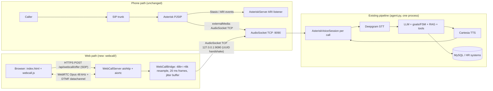

# Web call: "Try our HR Voicebot" button -> same voice pipeline as phone calls

## Run it
```bash
cd hr_voice_agent_asterisk_pipeline
cp .env.example .env            # fill DEEPGRAM_API_KEY, CARTESIA_API_KEY, MySQL, ARI_* ...
./run_webcall.sh selftest       # optional: proves WebRTC <-> AudioSocket works (no Asterisk/keys needed)
./run_webcall.sh                # starts agent.py (Asterisk ARI + AudioSocket) AND the landing page
```
Open `https://localhost:8443/` (accept the self-signed cert warning once), click **Try our HR Voicebot**.
Phone calls keep working exactly as before through Asterisk.

For other devices on your LAN: `scripts/gen_cert.sh localhost 192.168.x.x` then open `https://192.168.x.x:8443/`.
For the internet: put a real cert (Let's Encrypt) in `WEBCALL_CERT_FILE/KEY_FILE` and add a TURN server in `WEBCALL_ICE_SERVERS`.

## Architecture

Both paths end in the same `AsteriskVoiceSession` over AudioSocket (8 kHz mono PCM, 20 ms frames), so STT, LLM, RAG, tools, recording and monitoring are shared.

## Known differences for web calls
- Coordinator transfer uses ARI `redirect`; web calls have no Asterisk channel, so transfer is unavailable (caller label is `web-xxxxxx`).
- DTMF comes from the on-page keypad over a WebRTC data channel and calls the same `on_dtmf_digit` handler.
- Limits (calls, per-IP, per-minute, seconds) are env-controlled: `WEBCALL_MAX_CALLS`, `WEBCALL_PER_IP_MAX`, `WEBCALL_OFFERS_PER_MINUTE`, `WEBCALL_MAX_SECONDS`.
