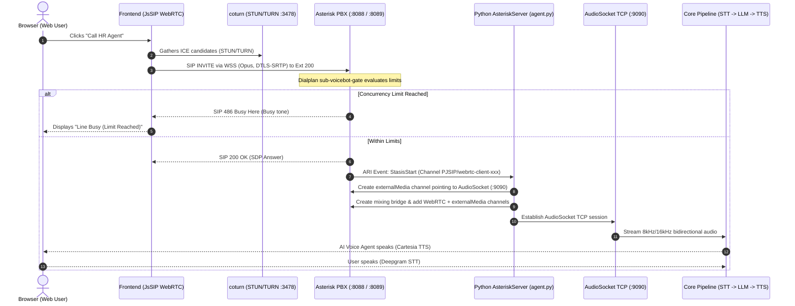

# WebRTC Integration with Asterisk (Option A) — Implementation Guide

## Architecture Overview



---

## 1. What Has Been Implemented

### Step 1: Asterisk Server Configuration
* **[`asterisk_config/http.conf`](file:///home/eoxys/RK/AgenticVoiceBot/asterisk_config/http.conf)**:
  * HTTP server enabled on port `8088` (for unencrypted WS development).
  * HTTPS/WSS enabled on port `8089` (`tlsenable=yes`, `tlsbindaddr=0.0.0.0:8089`, certificates loaded from `/etc/asterisk/keys/`).
* **[`asterisk_config/rtp.conf`](file:///home/eoxys/RK/AgenticVoiceBot/asterisk_config/rtp.conf)**:
  * ICE support enabled (`icesupport=yes`).
  * STUN address configured (`stunaddr=stun.l.google.com:19302`).
  * RTP port range set to `10000-20000`.
* **[`asterisk_config/pjsip.conf`](file:///home/eoxys/RK/AgenticVoiceBot/asterisk_config/pjsip.conf)**:
  * Transports added: `[transport-ws]` (WS :8088) and `[transport-wss]` (WSS :8089).
  * WebRTC template `[webrtc-endpoint-template]` configured with:
    * `webrtc=yes`
    * `media_encryption=dtls`, `dtls_auto_generate_cert=yes`, `dtls_verify=fingerprint`, `dtls_setup=actpass`
    * `ice_support=yes`, `rtcp_mux=yes`, `use_avpf=yes`, `bundle=yes`
    * `allow=opus,ulaw,alaw`
  * Endpoints created: `[webrtc-client]` and Extension `[200]`.
* **[`asterisk_config/extensions.conf`](file:///home/eoxys/RK/AgenticVoiceBot/asterisk_config/extensions.conf)**:
  * Extension `200` routes directly into `sub-voicebot-gate`.
  * Active session tracking with `GROUP()` and `GROUP_COUNT()`.
  * Automatic `Busy(5)` call rejection (SIP 486 Busy Here) when `GLOBAL_MAX_TOTAL_CALLS` is reached.
  * Successful calls enter `Stasis(hr_voicebot)` to link with the AI agent.

### Step 2: TURN Server (coturn) Configuration
* **[`asterisk_config/turnserver.conf`](file:///home/eoxys/RK/AgenticVoiceBot/asterisk_config/turnserver.conf)**:
  * Listening on port `3478` (UDP/TCP) and `5349` (TLS).
  * Pre-configured with public IP `115.99.235.223`, ports `49152-65535`, credentials `hrbot` / `TurnSecretPass2026`.
* **[`asterisk_config/setup_coturn.sh`](file:///home/eoxys/RK/AgenticVoiceBot/asterisk_config/setup_coturn.sh)**:
  * Automated installation and systemd service setup for Ubuntu/Debian.

### Step 3: Frontend WebRTC Calling Interface
* **[`hr_voice_agent_asterisk_pipeline/web/jssip.min.js`](file:///home/eoxys/RK/AgenticVoiceBot/hr_voice_agent_asterisk_pipeline/web/jssip.min.js)**:
  * Vendored MIT-licensed official JsSIP client (v3.10.0).
* **[`hr_voice_agent_asterisk_pipeline/web/index.html`](file:///home/eoxys/RK/AgenticVoiceBot/hr_voice_agent_asterisk_pipeline/web/index.html)**:
  * "Call HR Agent" interactive button with live audio visualizer meters, status pills, dialpad, and mute/hangup controls.
* **[`hr_voice_agent_asterisk_pipeline/web/webcall.js`](file:///home/eoxys/RK/AgenticVoiceBot/hr_voice_agent_asterisk_pipeline/web/webcall.js)**:
  * Establishes secure WSS connection directly to Asterisk (`wss://<host>:8089/ws` or `ws://<host>:8088/ws`).
  * Initiates SIP INVITE to Extension `200` with ICE STUN/TURN configurations.
  * Handles Asterisk `Busy(5)` / SIP 486 responses cleanly on screen.
  * Transmits in-call DTMF directly over SIP INFO / RFC 4733.

### Step 4: Python Voice Agent Integration
* Reuses [`hr_voice_agent_asterisk_pipeline/agent.py`](file:///home/eoxys/RK/AgenticVoiceBot/hr_voice_agent_asterisk_pipeline/agent.py) and [`hr_voice_agent_asterisk_pipeline/asterisk/server.py`](file:///home/eoxys/RK/AgenticVoiceBot/hr_voice_agent_asterisk_pipeline/asterisk/server.py).
* Asterisk ARI automatically receives `StasisStart` when a WebRTC call connects.
* Creates `externalMedia` bridge to AudioSocket TCP `:9090`.
* 100% of existing STT (Deepgram), TTS (Cartesia), LLM (Ollama/OpenAI), RAG, and HR Database tools run untouched.

---

## 2. Deployment Instructions

### Apply Asterisk Configuration:
```bash
cd /home/eoxys/RK/AgenticVoiceBot/asterisk_config
sudo bash install_asterisk_config.sh
```

### Install & Start coturn TURN Server (Optional for NAT/firewall traversal):
```bash
cd /home/eoxys/RK/AgenticVoiceBot/asterisk_config
sudo bash setup_coturn.sh
```

### Start the HR Voice Agent Pipeline:
```bash
cd /home/eoxys/RK/AgenticVoiceBot/hr_voice_agent_asterisk_pipeline
./run_webcall.sh
```

Open `https://localhost:8443/` (or `https://<server-ip>:8443/`), click **"Call HR Agent"**, and speak directly into your browser microphone!

