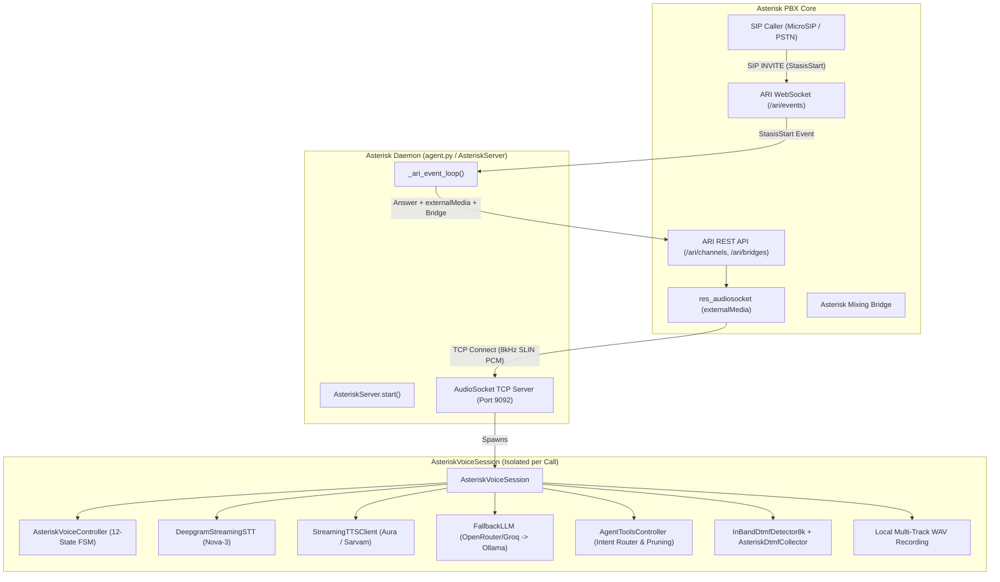
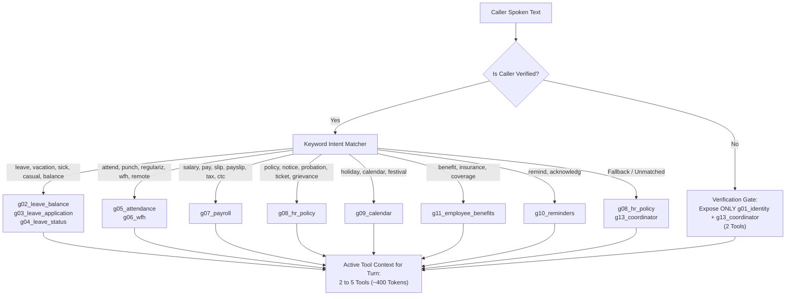
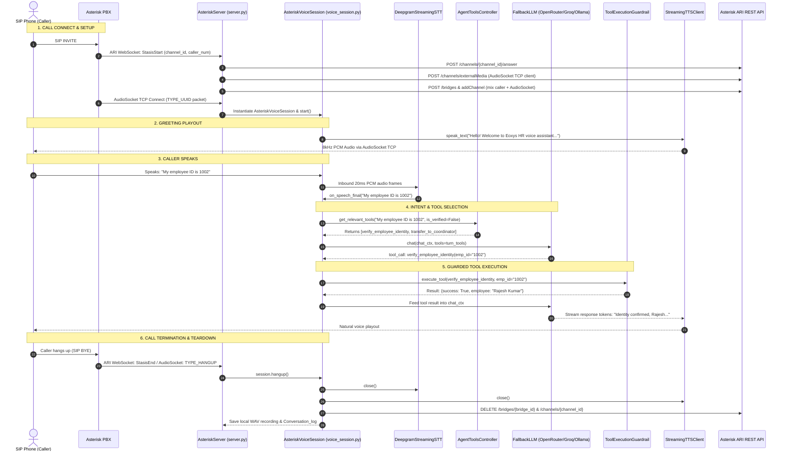

# Asterisk Telephony Pipeline Architecture & Execution Flow
**Agentic HR VoiceBot (Asterisk ARI + AudioSocket Backend)**  
*Comprehensive Technical Reference & Code Walkthrough*

---

## 1. Executive Summary & Architecture Overview

The Asterisk Telephony Pipeline in the HR Voice Agent enables bidirectional, real-time conversational telephony without reliance on external WebRTC gateways. It combines:
1. **Asterisk ARI (Asterisk REST Interface) & Stasis**: For asynchronous call control, answering, channel bridging, DTMF events, and call redirection/transfer.
2. **Asterisk AudioSocket (TCP Stream)**: For bidirectional 8kHz linear 16-bit PCM audio transport between Asterisk and the Python daemon.
3. **Deepgram Nova-3 Streaming STT**: Real-time speech-to-text with VAD (Voice Activity Detection) and instant barge-in support.
4. **Streaming TTS (Deepgram Aura / Sarvam AI)**: Low-latency sentence-pipelined speech synthesis with audio pacing (20ms frames).
5. **Hybrid LLM (OpenRouter / Groq with Local Ollama Fallback)**: Intelligent agent reasoning with native `think: false` suppression and zero-latency local fallback.
6. **12-State FSM Controller (`AsteriskVoiceController`)**: Telephony state machine tracking lifecycle, watchdogs, and global monitor telemetry.
7. **Intent-Driven Dynamic Tool Pruning (`AgentToolsController`)**: Prunes the 44 domain tools (~5,400 prompt tokens) down to 2–5 tools (~400 tokens) per turn based on caller verification and intent keywords.



---

## 2. Directory Structure & Key Files

```text
hr_voice_agent_asterisk_pipeline/
├── main.py                          # CLI entrypoint; launches email daemon and agent.py
├── agent.py                         # Daemon runner, signal handling, resource prewarming
├── config.py                        # Telephony, ARI, STT, TTS, and LLM configuration
├── prompts.py                       # System instructions and prompt templates
├── asterisk/
│   ├── server.py                    # AsteriskServer: AudioSocket TCP server + ARI WebSocket client
│   ├── voice_session.py             # AsteriskVoiceSession: Per-call orchestrator (STT, LLM, TTS, tools)
│   ├── audiosocket.py               # AudioSocket protocol encode/decode, 20ms frame pacer queue
│   ├── deepgram_stt.py              # Streaming WebSocket STT client (Deepgram Nova-3)
│   ├── tts_client.py                # Streaming TTS client (Deepgram Aura & Sarvam AI)
│   ├── llm_types.py                 # Asterisk LLM protocol types (ChatContext, ToolContext, etc.)
│   └── context.py                   # AsteriskRunContext & AsteriskJobContext compatibility shims
├── controllers/
│   ├── agentVoiceController.py      # AsteriskVoiceController: 12-state FSM state machine
│   ├── agentToolsController.py      # Master tool registry, intent routing, and dynamic tool pruning
│   └── global_monitor_fsm.py        # Machine-wide health monitor listening over local UDP
├── goals/
│   ├── base.py                      # GoalService base class and @function_tool discovery
│   ├── intent_router.py             # Keyword intent classification
│   ├── g01_identity_verification.py # Employee authentication & verification
│   ├── g02_leave_balance.py         # Sick, Casual, Earned leave balance queries
│   ├── g03_leave_application.py     # Leave requests & email approval dispatch
│   ├── g04_leave_status.py          # Checking leave application state
│   ├── g05_attendance.py            # Swipe records & regularizations
│   ├── g06_wfh.py                   # Work From Home quotas & requests
│   ├── g07_payroll.py               # Payslips, salary structure, and tax deductions
│   ├── g08_hr_policy.py             # Company policy queries, ticketing & grievances
│   ├── g09_calendar.py              # Company holidays and calendar lookups
│   ├── g10_reminders.py             # Policy acknowledgements & pending tasks
│   ├── g11_employee_benefits.py     # Insurance and perks lookups
│   ├── g12_leave_verification_outbound.py # Outbound leave verification
│   └── g13_coordinator_transfer.py  # Live SIP channel transfer to human HR coordinator
└── security/
    ├── call_blocklist.py            # Caller ID security validation and blocklist
    └── tool_guardrails.py           # Tool timeout, authorization, and circuit-breaker protection
```

---

## 3. Telephony Connection & Handshake Flow

### Phase A: ARI Signaling & Asterisk Mixing Bridge Setup
1. **Asterisk receives SIP INVITE** and pushes the incoming channel into Stasis:
   - File: `asterisk/server.py`
   - Function: `AsteriskServer._ari_event_loop()`
   - WebSocket URL: `ws://{ARI_HOST}/ari/events?app={ARI_APP_NAME}`
2. **ARI Event Dispatching**:
   - `_handle_ari_event(event)` receives event `StasisStart`.
   - Extracts `channel_id`, `caller_num` (SIP caller ID).
   - Filters out internal channels (`"AudioSocket"`, `"UnicastRTP"`).
   - **Security Blocklist Check**: Calls `is_number_blocked(caller_num)` (`security/call_blocklist.py`). If blocked, sends `DELETE /channels/{channel_id}` to reject immediately.
3. **Incoming Call Setup**:
   - Function: `AsteriskServer._setup_incoming_call(channel_id, caller_num)` (`asterisk/server.py`):
     - **Step 1: Answer Channel**: `POST /channels/{channel_id}/answer`.
     - **Step 2: Generate Call UUID**: `call_uuid = str(uuid.uuid4())` (RFC 4122 format required by Asterisk).
     - **Step 3: ExternalMedia Channel**: `POST /channels/externalMedia` telling Asterisk's `res_audiosocket` module to connect via TCP to Python's AudioSocket port:
       ```json
       {
         "app": "hr-voice-agent",
         "external_host": "127.0.0.1:9092",
         "format": "slin",
         "encapsulation": "audiosocket",
         "transport": "tcp",
         "connection_type": "client",
         "data": "<call_uuid>"
       }
       ```
     - **Step 4: Create Mixing Bridge**: `POST /bridges` with type `"mixing"`, named `bridge_<call_uuid>`.
     - **Step 5: Bridge Channels**: `POST /bridges/{bridge_id}/addChannel?channel={channel_id},{ext_channel_id}`.
     - *Result*: Asterisk bridges the telephone caller to the Python TCP connection.

### Phase B: AudioSocket TCP Handshake & Session Spawn
1. **TCP Connection Accepted**:
   - File: `asterisk/server.py`
   - Function: `AsteriskServer._handle_audiosocket_client(reader, writer)`
2. **AudioSocket Handshake Packet**:
   - Reads the initial 3-byte header + payload via `read_packet(reader)` (`asterisk/audiosocket.py`).
   - Expects `TYPE_UUID (0x01)` with 16-byte UUID payload matching the pending `call_uuid`.
3. **Session Instantiation**:
   - Instantiates `AsteriskVoiceSession` (`asterisk/voice_session.py`).
   - Stores session: `self.active_sessions[channel_id] = session`.
   - Executes `await session.start()`.

---

## 4. Subsystems: Initialization & Internal Mechanics

### A. Telephony Server (`asterisk/server.py`)
- **`AsteriskServer.start()`**:
  1. Starts `GlobalMonitorFSM` background thread.
  2. Runs `prewarm_worker_resources()` to prime Ollama and check database tables.
  3. Launches `start_email_approval_daemon()` (polls manager approval inbox every 15s).
  4. Starts the TCP server on `AST_BRIDGE_HOST:AST_BRIDGE_PORT` (listening for Asterisk audio).
  5. Connects to Asterisk via WebSocket (`ws://{ARI_HOST}/ari/events?app={ARI_APP_NAME}`).
- **`_handle_ari_event(event)`**:
  - Handles `StasisStart`: Verifies caller ID blocklist and triggers `_setup_incoming_call()`.
  - Handles `ChannelDtmfReceived`: Dispatches keypad digits to the active voice session.
  - Handles `StasisEnd`: Triggers call cleanup and bridge destruction.
- **`_handle_audiosocket_client(reader, writer)`**:
  - Reads `TYPE_UUID (0x01)` packet, resolves `call_uuid` to channel ID, and launches `AsteriskVoiceSession`.

---

### B. STT Engine (`asterisk/deepgram_stt.py`)
- **Class**: `DeepgramStreamingSTT`
- **Audio Format**: Raw linear 16-bit PCM @ 8000 Hz, 1 channel.
- **Protocol**: Direct streaming WebSocket to `wss://api.deepgram.com/v1/listen`.
- **Key Parameters**:
  - `model="nova-3"`
  - `endpointing=240` (240ms silence threshold for rapid end-of-speech detection)
  - `interim_results=true` (used for verified speech barge-in)
  - `vad_events=true` (voice activity triggers)
- **Callbacks**:
  - `on_speech_started`: Marks candidate interruption onset.
  - `on_interim`: Checks for spoken words during agent playback. If words occur, calls `session.interrupt()`.
  - `on_speech_final`: Triggers user turn processing (`_on_user_speech_final()`).

---

### C. TTS Engine (`asterisk/tts_client.py`)
- **Class**: `StreamingTTSClient`
- **Output Transport**: Streams into `AudioSocketWriterQueue` (`asterisk/audiosocket.py`), which paces frames into standard 20ms chunks (160 samples = 320 bytes @ 8kHz) to match telephony clocking.
- **Provider Switching**:
  - `TTS_PROVIDER="deepgram"`: Streams 8kHz linear PCM directly from Deepgram Aura.
  - `TTS_PROVIDER="sarvam"`: Used for Indic languages (`ta`, `kn`); synthesizes via Sarvam REST API, resamples to 8kHz, and enqueues.
- **Sentence Pipelining**: Uses `SENTENCE_SPLIT_REGEX` to split incoming LLM streaming tokens on clause boundaries (`.`, `!`, `?`, `,`). Dispatches early clauses to TTS so the user hears voice within 300–500ms while the LLM is still generating subsequent tokens.

---

### D. LLM & Fallback Engine (`ollama_llm.py`)
- **Class**: `FallbackLLM` wrapping `OpenAICompatibleLLM` + `OllamaLLM`.
- **Primary LLM**: Cloud OpenRouter (Qwen 2.5 72B Instruct) or Groq (Qwen 3.8 27B).
- **Secondary / Backup LLM**: Local Ollama server (`http://localhost:11434`).
  - Calls native `/api/chat` with `"think": false` to suppress thinking tags at the computation layer, reducing latency from ~70s to ~3s on local hardware.
- If cloud APIs experience rate limits, HTTP errors, or network dropped connections, `FallbackLLM` immediately switches to local Ollama without dropping the call.

---

### E. 12-State FSM Controller (`controllers/agentVoiceController.py`)
- **Class**: `AsteriskVoiceController`
- **States (`ControllerState`)**:
  1. `UNINITIALIZED`: Initial object instantiation.
  2. `INITIALIZING`: Engine wrappers built.
  3. `PREWARMING`: Priming Ollama & DB connection checks.
  4. `READY`: Standby, waiting for call.
  5. `JOB_ACCEPTED`: Call signal received from Asterisk.
  6. `CONNECTING`: AudioSocket & ARI channels connecting.
  7. `SESSION_ACTIVE`: Connected, call live.
  8. `LISTENING`: User speaking, STT active.
  9. `THINKING`: RAG retrieval, LLM generating, tool executing.
  10. `SPEAKING`: TTS streaming voice over AudioSocket.
  11. `ENDING`: Call hanging up, cleaning up resources.
  12. `ERROR`: Exception or watchdog timeout occurred.
- **Watchdogs**:
  - `stt_timeout`: 30.0s
  - `llm_timeout`: 30.0s
  - `tts_timeout`: 20.0s
  - `caller_connect_timeout`: 30.0s
- State transitions are synchronized with `GlobalMonitorFSM` via UDP datagrams (`report_agent_event()`).

---

## 5. Intent Routing & Dynamic Tool Pruning

### Problem Solved: Tool Context Bloat
The application includes 13 domain goal services comprising **44 individual `@function_tool` functions (~5,400 prompt tokens)**. Passing all 44 tools into every turn causes:
1. LLM rate limit exhaustion (e.g. Groq 7,000 ITPM limit).
2. Increased latency (high Time-To-First-Token).
3. Tool hallucinations and incorrect parameter guessing.

### Solution: 2-Tier Dynamic Tool Pruning
Before each conversational turn, `AsteriskVoiceSession._get_relevant_tools_for_turn(user_text)` calls `AgentToolsController.get_relevant_tools(user_text, is_verified)`:



- **Result**: Reduces token usage from **5,400 tokens to ~400 tokens per turn** (a **>90% reduction**).

---

## 6. Complete End-to-End Execution Trace (Call Connect to End)

### A. End-to-End Sequence Diagram



---

### B. End-to-End System State & Process Flowchart

```mermaid
flowchart TD
    StartCall(["Caller dials HR Agent"]) --> ARI_StasisStart["Asterisk triggers StasisStart event"]
    ARI_StasisStart --> SecCheck{"Caller ID Blocked?"}
    SecCheck -->|Yes| DropCall["Hangup channel & abort"]
    SecCheck -->|No| AnswerAndBridge["1. Answer channel<br/>2. Create externalMedia (SLIN)<br/>3. Create mixing bridge<br/>4. Bridge caller + externalMedia"]

    AnswerAndBridge --> TCP_Handshake["Asterisk connects to AudioSocket TCP :9092<br/>Sends TYPE_UUID packet"]
    TCP_Handshake --> InitSession["Spawn AsteriskVoiceSession<br/>• DeepgramStreamingSTT<br/>• StreamingTTSClient<br/>• FallbackLLM<br/>• AsteriskVoiceController FSM"]

    InitSession --> PlayGreeting["TTS synthesizes greeting<br/>AudioSocketWriterQueue paces 20ms frames"]
    PlayGreeting --> AudioLoop["_inbound_audio_loop running<br/>Reads 8kHz PCM from Asterisk"]

    AudioLoop --> AudioFanOut{"Inbound Audio Processing"}
    AudioFanOut -->|1. Deepgram STT| STT_Stream["WebSocket raw PCM streaming"]
    AudioFanOut -->|2. In-band Goertzel| DTMF_Detect["Goertzel 8kHz DTMF detector<br/>AsteriskDtmfCollector (4-digit ID)"]
    AudioFanOut -->|3. Local Recording| WAV_Writer["Multi-track WAV mixer<br/>Conversation_Audio.wav"]

    STT_Stream --> VAD_Event{"Speech Event"}
    VAD_Event -->|Interim words during speaking| BargeIn["Barge-In triggered!<br/>Clear TTS buffer & interrupt()"]
    VAD_Event -->|on_speech_final| ProcessTurn["_process_user_turn(user_text)"]

    ProcessTurn --> RAG_Check{"Policy Query? (needs_rag)"}
    RAG_Check -->|Yes| RAG_Fetch["HttpRetriever.search()<br/>Play latency filler clip if >500ms<br/>Inject knowledge snippets"]
    RAG_Check -->|No| ToolPruning

    RAG_Fetch --> ToolPruning["AgentToolsController.get_relevant_tools()<br/>Prune 44 tools -> 2-5 tools"]
    ToolPruning --> LLM_Chat["FallbackLLM.chat(chat_ctx, turn_tools)<br/>Stream tokens directly to TTS"]

    LLM_Chat --> ToolCallCheck{"Tool Call Generated?"}
    ToolCallCheck -->|No Tool Call| TTS_Out["TTS completes voice playout<br/>FSM -> LISTENING"]
    ToolCallCheck -->|Tool Call| ToolGuard["ToolExecutionGuardrail<br/>• Timeout (3.5s)<br/>• Least privilege verification<br/>• Circuit breaker"]
    
    ToolGuard --> ToolExec["Execute Goal Action (g01-g13)"]
    ToolExec --> FeedResult["Feed tool output into chat_ctx"]
    FeedResult --> LLM_Followup["LLM generates spoken explanation"]
    LLM_Followup --> TTS_Out

    TTS_Out --> WaitNextUtterance["Wait for caller response / loop"]

    WaitNextUtterance --> HangupTrigger{"Call Termination Event<br/>(SIP BYE / TYPE_HANGUP / Transfer)"}
    HangupTrigger -->|Transfer Requested| RedirectARI["ARI Channel Redirect -> PJSIP/{coordinator}"]
    HangupTrigger -->|Hangup| TeardownSession["session.hangup()<br/>• Close STT & TTS<br/>• Flush & close WAV recording<br/>• Destroy ARI bridge & channel<br/>• FSM state -> READY"]
    RedirectARI --> TeardownSession
    TeardownSession --> EndCall(["Session Closed Cleanly"])
```



---

### C. Detailed Step-by-Step Breakdown

#### 1. Audio Streaming Loop
- **Function**: `AsteriskVoiceSession._inbound_audio_loop()` (`asterisk/voice_session.py`)
- Continuously reads 20ms audio packets from Asterisk TCP stream.
- Forwards raw PCM to Deepgram STT (`self.stt.send_audio(payload)`).
- In-band Goertzel algorithm checks for DTMF tones (`InBandDtmfDetector8k.process_block(samples)`).
- Mixes agent and user audio into local WAV file (`self._wav_writer.writeframes(mixed)`).

#### 2. Barge-In Detection (Instant Interruption)
- When the agent is speaking (`agent_state == "speaking"`), if the caller starts speaking words:
  - `_on_user_interim_transcript(interim_text)` (`voice_session.py`) detects verified spoken words.
  - Calls `session.interrupt()`:
    - Clears `self.tts.interrupt()`.
    - Empties outbound `AudioSocketWriterQueue`.
    - Cancels current processing task (`self._current_turn_task.cancel()`).
    - Updates state to `listening`.

#### 3. User Turn Processing (`_process_user_turn`)
- **File**: `asterisk/voice_session.py`
- **RAG Check**: Calls `_handle_rag(user_text)`. If query matches policy/handbook information, queries `HttpRetriever`. If latency $> 0.5$s, plays filler clip ("Let me check that policy for you real quick..."). Injects retrieved policy text into `chat_ctx`.
- **Tool Pruning**: Calls `_get_relevant_tools_for_turn(user_text)` via `AgentToolsController`.
- **LLM Streaming**: Calls `self.llm.chat(chat_ctx, tools=turn_tools)`.
- Tokens stream directly to TTS sentence synthesizer (`await self.tts.speak_stream(_token_generator())`).
- If the LLM generates a tool call:
  - Checked against **Premature Hangup Guard**: Prevents the LLM from accidentally ending the call when a user simply declines a specific option (e.g. saying "No").
  - Executes tool via `ToolExecutionGuardrail` (`security/tool_guardrails.py`), enforcing timeouts (3.5s), least-privilege checks, and circuit-breakers.
  - Feeds tool execution output back into `chat_ctx` as a system instruction and triggers a follow-up LLM stream so the assistant naturally explains the result to the caller.

#### 4. Call Transfer (Coordinator Escalation)
- If the user asks for a human coordinator or `transfer_to_coordinator` tool runs:
  - **File**: `asterisk/voice_session.py`
  - **Method**: `AsteriskVoiceSession.transfer_call(target)`
  - Executes an ARI redirect: `POST /channels/{channel_id}/redirect?endpoint=PJSIP/{target}`.
  - Directly transfers the caller's phone line to the coordinator's extension or phone number.

#### 5. Call End & Teardown
- Triggers when Asterisk sends `StasisEnd` or AudioSocket receives `TYPE_HANGUP (0x00)`:
  - **Method**: `AsteriskVoiceSession.hangup()` (`voice_session.py`)
  - FSM transitioned: `voice_controller.on_call_end()`, moving FSM state from `SESSION_ACTIVE` $\rightarrow$ `ENDING` $\rightarrow$ `READY`.
  - Closes `DeepgramStreamingSTT` WebSocket.
  - Closes `StreamingTTSClient` and flushes `AudioSocketWriterQueue`.
  - Closes local `.wav` recording file and writes finalized `Conversation_log`.
  - Deletes Asterisk mixing bridge (`DELETE /bridges/{bridge_id}`) and channel.
  - Clears session from `AsteriskServer.active_sessions`.

---

## 7. Security & Guardrails

1. **Call Blocklist (`security/call_blocklist.py`)**:
   - Checked during `StasisStart` prior to channel answering.
   - Blocks spam/harassing numbers with zero compute overhead.
2. **Identity Verification Gate (`goals/helpers.py`)**:
   - `@require_verified` decorator wraps all sensitive operations (leaves, salary, attendance).
   - If an unverified user attempts to query private data, the tool immediately aborts and returns an authentication requirement message.
3. **Tool Execution Guardrail (`security/tool_guardrails.py`)**:
   - Least-privilege validation: ensures tools can only access data belonging to the verified caller.
   - Execution timeout: 3.5 seconds per tool call.
   - Circuit breaker: prevents repetitive cascading tool errors from stalling the call.
4. **Premature Hangup Guard (`asterisk/voice_session.py`)**:
   - Prevents the LLM from executing `end_call` if the user declined an optional offer (e.g. "No, that's fine") without actually saying goodbye.

---

## 8. Call Teardown & Post-Call Artifacts

When a call ends (either via caller hangup, agent hangup, or coordinator transfer):
1. **FSM State Update**: Transitions `SESSION_ACTIVE` $\rightarrow$ `ENDING` $\rightarrow$ `READY`.
2. **Audio Streams Closed**: `DeepgramStreamingSTT` and `StreamingTTSClient` WebSocket and HTTP sessions are cleanly disconnected.
3. **Asterisk Channel Cleanup**:
   - Sends `DELETE /bridges/{bridge_id}` to destroy the mixing bridge.
   - Sends `DELETE /channels/{channel_id}` to hang up any remaining channel leg.
4. **Local Recording Saved**:
   - Multi-track WAV audio saved to:  
     `Recordings/{DD-MM-YYYY}/User-ast-{UUID}-{HH.MM}/Conversation_Audio.wav`
5. **Turn-by-Turn Transcript Log**:
   - Appended to:  
     `Recordings/{DD-MM-YYYY}/User-ast-{UUID}-{HH.MM}/Conversation_log`
6. **Session Registry Reset**: Removed from `AsteriskServer.active_sessions`.
